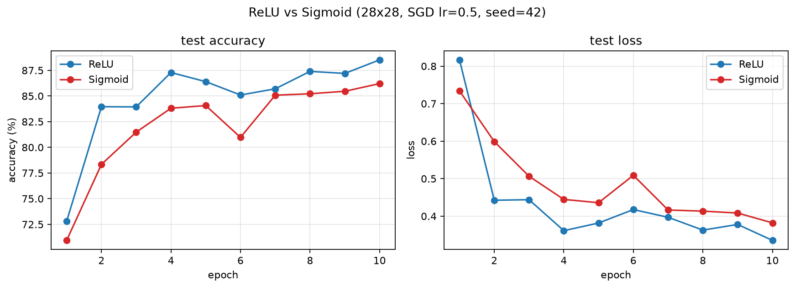

# Fashion-MNIST MLP 实验记录

## 1. 实验目的

在 Fashion-MNIST 上训练 MLP，比较以下变量对分类结果的影响：

- 输入尺寸：28×28 / 32×32
- 激活函数：ReLU / Sigmoid
- 优化器：Adam / SGD
- 隐藏层数：2 / 3

记录指标为 train accuracy、test accuracy、train/test gap、test loss，以及每类分类结果和混淆矩阵。

## 2. 数据与模型

Fashion-MNIST：60,000 张训练图，10,000 张测试图，10 类，原始尺寸 28×28，灰度图。

预处理：

```python
transforms.ToTensor()
transforms.Normalize(mean=(0.2860,), std=(0.3530,))
```

28×28 模型：

```python
nn.Flatten(),
nn.Linear(28 * 28, 256), nn.ReLU(),
nn.Linear(256, 128), nn.ReLU(),
nn.Linear(128, 10)
```

输入维度由图片尺寸决定：28×28 展平为 784，32×32 展平为 1024。`nn.Linear(in_features, out_features)` 的参数量为 `in_features * out_features + out_features`。

| 模型 | 第一层 | 总参数量 |
|---|---|---:|
| 28×28 | Linear(784, 256) | 235,146 |
| 32×32 | Linear(1024, 256) | 296,586 |

## 3. 实验设置

| 项目 | 设置 |
|---|---|
| loss | CrossEntropyLoss |
| batch size | 256 |
| epochs | 10 |
| seed | 42 |
| 优化器 | Adam lr=1e-3；SGD lr=0.5 |
| 设备 | NVIDIA GeForce RTX 4060 Laptop |
| 软件 | Python 3.14，torch 2.13.0+cu126，torchvision 0.28.0+cu126 |

## 4. 实验结果

### 4.1 总表

| 配置 | 参数量 | train acc | test acc | gap | test loss |
|---|---:|---:|---:|---:|---:|
| 28×28, ReLU, Adam | 235,146 | 92.20% | 88.70% | 3.50 pt | 0.3300 |
| 32×32, ReLU, Adam | 296,586 | 91.46% | 89.02% | 2.44 pt | 0.3164 |
| 28×28, ReLU, SGD lr=0.5 | 235,146 | 91.51% | 88.52% | 2.99 pt | 0.3355 |
| 28×28, Sigmoid, SGD lr=0.5 | 235,146 | 88.05% | 86.21% | 1.84 pt | 0.3822 |

### 4.2 ReLU 与 Sigmoid

两组都使用 28×28、SGD lr=0.5、10 epoch、seed=42。

| epoch | ReLU test acc | Sigmoid test acc | ReLU test loss | Sigmoid test loss |
|---:|---:|---:|---:|---:|
| 1 | 72.80% | 70.94% | 0.8167 | 0.7340 |
| 5 | 86.40% | 84.07% | 0.3817 | 0.4359 |
| 10 | 88.52% | 86.21% | 0.3355 | 0.3822 |



完整逐 epoch 数据在 `results/activation_compare.csv`。

### 4.3 每类结果

28×28、ReLU、Adam 的最终模型：

| 类别 | precision | recall | F1 |
|---|---:|---:|---:|
| t-shirt | 83.40% | 84.90% | 84.14% |
| trouser | 98.29% | 97.70% | 97.99% |
| pullover | 81.72% | 79.60% | 80.65% |
| dress | 88.14% | 89.90% | 89.01% |
| coat | 75.93% | 87.40% | 81.26% |
| sandal | 97.46% | 95.80% | 96.62% |
| shirt | 76.05% | 63.20% | 69.03% |
| sneaker | 91.49% | 97.80% | 94.54% |
| bag | 97.10% | 97.10% | 97.10% |
| ankle boot | 97.50% | 93.60% | 95.51% |

主要混淆：

```text
shirt -> t-shirt       120 张
shirt -> coat          109 张
shirt -> pullover       86 张
pullover -> coat       123 张
coat -> pullover        71 张
ankle boot -> sneaker   56 张
```

完整数据在 `results/img28_relu_adam_ep10_seed42/per_class.csv` 和 `confusion_matrix.csv`。

## 5. 分析

### 5.1 激活函数

相同 SGD 配置下，ReLU 比 Sigmoid 高 2.31 pt（88.52% 对 86.21%）。第 1 个 epoch 的 train acc 分别为 74.58% 和 59.66%，ReLU 收敛更快。

Sigmoid 的 train/test gap 更小（1.84 pt 对 2.99 pt），但 train acc 和 test acc 都更低。gap 小本身不代表模型更好。

### 5.2 输入尺寸

32×32 比 28×28 高 0.32 pt（89.02% 对 88.70%），参数量多 61,440。Fashion-MNIST 原图是 28×28，放大到 32×32 只做插值，没有增加新信息。单个 seed 下，这个差异不足以证明 32×32 更好。

### 5.3 优化器

28×28 ReLU 下，Adam 的 test acc 是 88.70%，SGD lr=0.5 是 88.52%，最终只差 0.18 pt。

差异主要在前期：第 1 个 epoch Adam 的 test acc 是 84.04%，SGD 是 72.80%。SGD 的 test acc 在第 5 到第 6 轮从 86.40% 降到 85.10%，波动比 Adam 大。

### 5.4 隐藏层数

早期 notebook 记录的两个模型：

| 配置 | 参数量 | test acc | gap | test loss |
|---|---:|---:|---:|---:|
| 2 隐藏层 256-128 | 235,146 | 88.70% | 3.50 pt | 0.3300 |
| 3 隐藏层 256-256-128 | 300,938 | 89.10% | 3.05 pt | 0.3242 |

3 隐藏层比 2 隐藏层高 0.40 pt，参数量多约 28%。增加容量的收益很小。

### 5.5 过拟合程度

28×28 ReLU Adam：

```text
train acc  92.20%
test acc   88.70%
gap         3.50 pt
test loss   0.3300
```

test loss 在第 6 轮附近最低，约为 0.3285，最后一轮为 0.3300，没有持续上升；test acc 仍在缓慢提高。当前属于轻度过拟合，同时训练还没有完全收敛。

### 5.6 错误类型

主要错误集中在 `shirt`、`coat`、`pullover`、`t-shirt` 之间。`shirt` 的 recall 只有 63.20%，其中 120 张被分成 `t-shirt`，109 张被分成 `coat`，86 张被分成 `pullover`。

这几类衣服的轮廓和纹理接近，MLP 只把图片展平成一维向量，缺少局部空间结构信息，因此容易混淆。

## 6. 结论

1. 在相同优化器和学习率下，ReLU 明显优于 Sigmoid。
2. 28×28 和 32×32 的差异只有 0.32 pt，当前数据不能证明 32×32 更好。
3. 从 2 层增加到 3 层只提升 0.40 pt，参数量增加 28%，收益很小。
4. 28×28 ReLU Adam 的 gap 为 3.50 pt，test loss 基本稳定，属于轻度过拟合。
5. 主要失分来自上衣类之间的互相错分，下一步可以尝试 CNN、数据增强或针对性补充难例。

## 7. 复现

```bash
python train.py --img-size 28 --activation relu --optimizer adam --epochs 10 --seed 42
python train.py --img-size 32 --activation relu --optimizer adam --epochs 10 --seed 42
python train.py --img-size 28 --activation relu --optimizer sgd --lr 0.5 --epochs 10 --seed 42
python train.py --img-size 28 --activation sigmoid --optimizer sgd --lr 0.5 --epochs 10 --seed 42
```

每组结果保存在 `results/<run_id>/`，包括 `config.json`、`history.csv`、`per_class.csv`、`confusion_matrix.csv`、`curve.png` 和 `confusion_matrix.png`。

## 8. 文件

| 文件 | 内容 |
|---|---|
| `train.py` | 训练、评估、保存结果 |
| `Fashion-MNIST.ipynb` | 交互实验记录 |
| `results/summary.csv` | 所有运行汇总 |
| `results/activation_compare.csv` | ReLU/Sigmoid 逐 epoch 对比 |
| `results/activation_compare.png` | ReLU/Sigmoid 曲线 |
| `results/<run_id>/history.csv` | 逐 epoch 指标 |
| `results/<run_id>/per_class.csv` | 每类 precision/recall/F1 |
| `results/<run_id>/confusion_matrix.csv` | 10×10 混淆矩阵 |

## 9. 实验限制

- 当前每组只跑了一个 seed。小于 0.5 pt 的差异需要多 seed 验证。
- 3 隐藏层和 Dropout 结果来自早期 notebook 记录，未用当前 `train.py` 复跑。
- 不同硬件和软件版本可能产生小幅数值差异。
